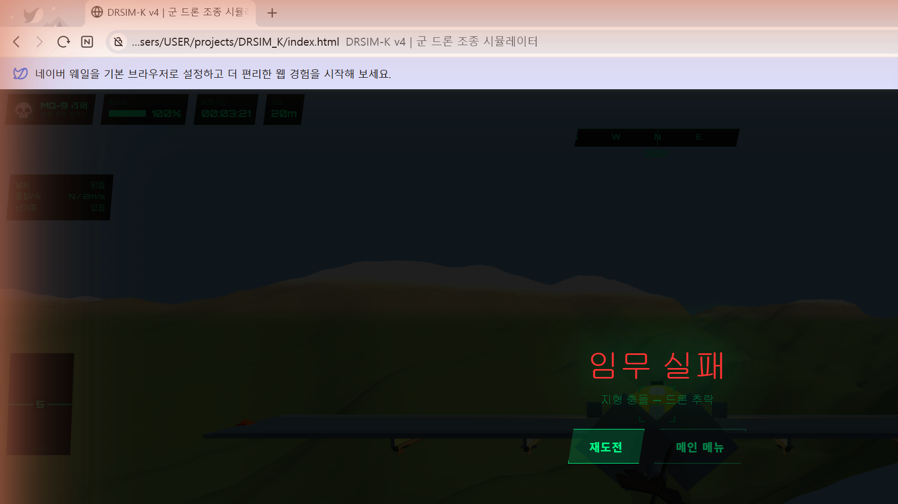

# DRSIM-K

**English:** [README.md](README.md)

> **대한민국 군 드론 조종사 훈련 시뮬레이터** — 대한민국 군 훈련 상황을 다루는 브라우저 기반 3D 드론 비행 시뮬레이션입니다. 빌드 도구나 외부 프레임워크 없이 순수 자바스크립트와 Three.js만으로 만들었습니다.

---

## 스크린샷



---

## 기술 스택

| 기술 | 버전 / 내용 |
|---|---|
| **Three.js** | r128 (CDN `<script>` 태그로 불러옴) |
| **JavaScript** | 순수 ES6+, `'use strict'`, 프레임워크 없음 |
| **렌더링** | WebGLRenderer · PCFSoftShadowMap · 2048×2048 그림자 맵 |
| **실행 환경** | 브라우저에서 바로 실행 — `index.html`을 직접 열면 됨 (서버 불필요). 단, Three.js를 cdnjs CDN에서 불러오므로 인터넷 연결이 필요 |
| **빌드 도구** | **없음** — `game.js` 파일 하나, `index.html`을 직접 열면 됨 |
| **입력** | 키보드 `keydown/keyup` + 게임패드 API 폴링 + 마우스 드래그 |

---

## 시작하기

설치나 빌드 과정이 필요 없습니다.

```bash
git clone https://github.com/zaqxsw108091-create/DRSIM_K.git
cd DRSIM_K
```

그다음:
```
1. Open index.html in any modern browser (Chrome / Edge recommended)
2. Select drone, map, and mission → click "비행 개시"
```

1. 최신 브라우저(Chrome / Edge 권장)로 `index.html`을 엽니다.
2. 드론, 맵, 임무를 고른 뒤 **"비행 개시"**를 누릅니다.

> **참고:** `file://` 주소에서는 다른 출처의 리소스를 불러오는 요청이 막히기 때문에, 모든 에셋은 파일 안에 들어 있거나 코드로 생성됩니다. 따로 불러올 이미지나 오디오 파일이 없습니다. 외부 리소스는 Three.js 스크립트(cdnjs) 하나뿐이라, 처음 실행할 때 인터넷 연결이 필요합니다.

---

## 파일 구조

```
DRSIM_K/
├── index.html          # Shell: DOM layout, HUD elements, manual overlay, settings UI
├── style.css           # All visual styling — military green terminal aesthetic
├── game.js             # Everything else: 3D engine init, physics, AI, missions, HUD logic
├── DRSIM-K_기능목록.html  # Feature reference document (Korean)
└── screenshots/
    └── gameplay.png
```

- `index.html` — 뼈대: 화면 배치, HUD 요소, 설명서 오버레이, 설정 화면
- `style.css` — 모든 화면 스타일 (군용 녹색 터미널 느낌)
- `game.js` — 나머지 전부: 3D 엔진 초기화, 물리, AI, 임무, HUD 로직
- `DRSIM-K_기능목록.html` — 기능 목록 문서 (한국어)
- `screenshots/gameplay.png` — 게임 화면

시뮬레이션 전체(지형 생성, 드론 물리, 미사일 유도, 임무 상태, 카메라, HUD)가 **`game.js` 파일 하나(약 2,000줄)**에 들어 있습니다. 의도한 선택입니다. 빌드 부담이 없고, 바로 고쳐 볼 수 있고, 소스맵 없이 브라우저 개발자 도구로 직접 디버깅할 수 있습니다.

---

## 드론 — 20종

### 🔵 정찰 (5)
| ID | 이름 | 속도 | 최고 고도 | 체공 시간 |
|---|---|---|---|---|
| rq101 | RQ-101 송골매 | 120 km/h | 3 000 m | 180분 |
| rq900 | RQ-900 나이트아울 | 90 km/h | 4 000 m | 240분 |
| shadow | RQ-7 Shadow | 110 km/h | 4 600 m | 300분 |
| hermes | Hermes 450 | 176 km/h | 5 500 m | 420분 |
| sonmi | SONMI-01 소니미 | 60 km/h | 300 m | 30분 |

### 🔴 공격 (5)
| ID | 이름 | 속도 | 최고 고도 | 타격 임무 미사일 수 |
|---|---|---|---|---|
| mq9 | MQ-9 리퍼 | 482 km/h | 15 000 m | 6 |
| kh1 | KH-1 타격드론 | 200 km/h | 1 000 m | 4 |
| tb2 | Bayraktar TB2 | 222 km/h | 8 200 m | 4 |
| swarm | SWARM-K 군집 | 80 km/h | 500 m | 4 |
| lm1 | LM-1 배회탄 | 160 km/h | 4 500 m | 4 |

> 미사일 수는 임무 코드(`initMisGameplay`)에서 정해집니다. 대형 무장형(MQ-9)은 6발, 나머지 드론은 4발입니다. 방어 임무에서는 INT-K가 12발, 다른 드론은 99발입니다 (NET-1은 발사 대신 가까이 가서 적 드론을 포획합니다). 미사일 종류 이름(헬파이어 등)은 분위기용 설명일 뿐이고, 게임은 하나의 공통 유도 미사일 모델을 씁니다.

### 🟢 방어 (2)
| ID | 이름 | 방식 |
|---|---|---|
| net1 | NET-1 그물포획 | 위상배열 레이더 + RF 재머, 22 m 안에 들어오면 자동으로 그물 발사 |
| intk | INT-K 요격드론 | 스텔스 델타익, 유도 미사일 12발, 락온 거리 1 200 m |

### 🟡 지원 (3)
| ID | 이름 | 역할 |
|---|---|---|
| ls1 | LS-1 보급드론 | 탄약 / 의약품 보급 (호위 임무의 호위 대상) |
| medk | MED-K 의무드론 | 응급키트 투하 + 위치 중계 |
| com1 | COM-1 중계드론 | 공중 통신 중계기 |

### ⚪ 초소형 (5)
Black Hornet 3 · NI-1 나노아이 · Puma AE · RQ-11 Raven · SkyRanger R70

---

## 임무 시스템 — 8개 임무

| 분류 | 임무 | 제한 시간 | 점수 |
|---|---|---|---|
| 정찰 | 적 진지 정찰 임무 | 10분 | 1 000 |
| 정찰 | 고립 부대 위치 파악 | 8분 | 900 |
| 정찰 | NBC 오염 지역 탐지 | 12분 | 950 |
| 정찰 | 야간 감시 작전 | 15분 | 800 |
| 타격 | 침투 드론 격추 | 7분 | 1 200 |
| 타격 | 적 거점 정밀 타격 | 8분 | 1 300 |
| 방어 | 보급 드론 호위 | 9분 | 850 |
| 방어 | 전자전 방어 작전 | 10분 | 900 |

---

## 핵심 기술 구현

### 1 — 절차적 지형 생성

**코드:** `buildTerrain()`과 `noise(x, z)`

```js
function noise(x, z) {
  return Math.sin(x*1.2)*Math.cos(z*.9)*.5
       + Math.sin(x*.7+z*1.1)*.35
       + Math.cos(x*2.1-z*1.7)*.15;
}
```

**이 방식을 쓴 이유:**  
일반적인 펄린/심플렉스 노이즈는 외부 라이브러리가 필요하거나 직접 구현하면 약 300줄이 듭니다. 대신 **주파수와 진폭이 다른 사인/코사인 파동 세 개를 더하면** 자연스러워 보이는 불규칙한 기복이 생기고, 꼭짓점 하나당 곱셈 약 3번이면 되며, 외부 라이브러리도 필요 없습니다.

지형 종류마다 같은 공식을 주파수 배율과 겹치는 층 수(옥타브)만 바꿔 부릅니다.

```js
case 'mountain':
  h = noise(x*.007, z*.006)*80    // large mountain ridges (low freq, high amp)
    + noise(x*.018, z*.015)*28    // mid-sized valleys
    + noise(x*.038, z*.032)*11    // rocky detail
    + noise(x*.08,  z*.07 )*5     // surface roughness
    + noise(x*.16,  z*.14 )*2;    // fine pebble texture
  h *= 1 + 0.3*Math.abs(Math.sin(x*.004 + z*.003));  // slow ridge scaling
  if (h > 50) h = 50 + (h-50)*0.55;                  // soften steep peaks
```

(주석: 큰 산 능선(낮은 주파수, 큰 진폭) · 중간 크기 골짜기 · 바위 디테일 · 표면 거칠기 · 잔자갈 질감 · 느린 능선 배율 · 가파른 봉우리 완화)

산악 지형은 노이즈를 **다섯 겹** 쌓습니다. 겹마다 주파수는 높이고 진폭은 낮춥니다 — 프랙탈 브라운 운동(fBm)의 아이디어입니다. 그다음 느리게 변하는 능선 배율을 곱하고, 50 m보다 높은 부분은 부드럽게 눌러 봉우리가 바늘처럼 뾰족해지지 않게 합니다. 평야 지형은 완만한 세 겹만 씁니다. 실제 평지는 크고 완만하게 굽이치기 때문입니다.

**별도의 `getTerrainH(x, z)` 함수**는 실행 중에 **Three.js 레이캐스팅**으로 지형 높이를 구합니다. Y=2000에서 바로 아래로 광선을 쏴서 지형 메시와 만나는 점을 찾습니다. 그래서 돌려주는 높이가 화면에 그려진 표면과 정확히 같고, 공식이나 보간 오차가 0입니다. 메시가 만들어지기 전의 짧은 순간에는 예비용 노이즈 공식을 씁니다.

```js
_rayOrig.set(x, 2000, z);
_RC.set(_rayOrig, new THREE.Vector3(0,-1,0));
const hits = _RC.intersectObject(TERRAIN_MESH, false);
if (hits.length > 0) return hits[0].point.y;
```

**지형 충돌 판정** (`updatePhys`): 물리 프레임마다 `getTerrainH(GS.x, GS.z)`를 드론의 현재 고도와 비교합니다. 드론이 `지형 높이 + 0.8 m` 아래로 내려가면 폭발이 일어나고, 드론 메시가 숨겨지고, 임무가 `"지형 충돌 — 드론 추락"`으로 끝납니다. 바닥 고정(`GS.y = Math.max(GS.y, terrainH + 0.8)`)이 있어서 천천히 하강할 때 드론이 지형을 뚫고 지나가지 않습니다.

**장면 오브젝트 배치**에도 `getTerrainH`를 쓰며 경사 조건을 엄격하게 둡니다. 나무와 바위는 지형 높이와 주변 4점의 기울기가 모두 좁은 기준보다 낮은 곳에만 놓아서, 가파른 비탈에 떠 있는 물체가 없게 했습니다. 건물은 지형에 2 m 묻어서, 표면이 조금 울퉁불퉁해도 공중에 떠 보이지 않습니다.

꼭짓점 색은 `Float32Array` 버퍼 속성에 직접 굽습니다. `MeshLambertMaterial({vertexColors:true})`가 꼭짓점마다 색을 읽기 때문에 텍스처 파일이 필요 없고, GPU가 삼각형 안의 색을 자동으로 보간합니다. 색 경계는 딱 끊지 않고 부드러운 그라데이션(`Math.max(0, Math.min(1, (h-t0)/range))`)으로 이어서, 고도 경계에 이음선이 보이지 않습니다.

---

### 2 — 미사일 유도 (부드러운 순수 추적)

**코드:** `updateProjectiles()` (유도 부분)

```js
// Guidance core (smoothed pure pursuit):
const turn = Math.min(1, dt * 10.0);
m.vx += (dx/dist3 * curSpd - m.vx) * turn;
m.vy += (dy/dist3 * curSpd - m.vy) * turn;
m.vz += (dz/dist3 * curSpd - m.vz) * turn;
// Re-normalize to the current speed (launch speed ≈ 90 m/s)
const ns = Math.sqrt(m.vx*m.vx + m.vy*m.vy + m.vz*m.vz);
if (ns > 0.1) { const n = curSpd/ns; m.vx*=n; m.vy*=n; m.vz*=n; }
```

**이 방식을 쓴 이유:**  
진짜 비례항법 유도(PN)는 **시선각이 돌아가는 속도**를 계산해 그에 비례해 조향합니다. 더 정확하지만 더 복잡합니다. 이 게임은 그보다 단순한 방식(부드러운 순수 추적)을 쓰며, **PN과 같지 않습니다**. 매 프레임 현재 속도 방향을 *원하는* 방향(목표를 향하는 단위 벡터 × 속도) 쪽으로 섞어 줍니다. `turn` 계수 `dt * 10.0`이 미사일이 얼마나 세게 방향을 트는지 정합니다. 값이 크면 더 빨리 돌지만 급한 각도에서 지나쳐 버릴 수 있습니다.

주요 설계 결정:
- **0.35초 발사 대기** (`m.armT`) — 가까운 거리에서 미사일이 곧바로 유턴해 드론 쪽으로 돌아오는 것을 막습니다.
- **일정 속도로 다시 맞추기** — 유도 계산 후 매번 속도 크기를 다시 맞춰, 방향을 얼마나 틀든 발사 속도(약 90 m/s)를 유지합니다. 이게 없으면 급하게 돌 때 속도가 빠져나갑니다.
- **목표 Y +1.8 m 보정** (`ty = tg.position.y + 1.8`) — 높은 지형 위에 있는 목표의 *밑동*을 겨냥해서, 미사일이 차량이 아니라 그 아래 언덕에 박히던 버그를 고친 것입니다.
- **3D 명중 반경** — 지상 목표는 14 m, 적 드론은 9 m이며, 목표 중심까지의 거리로 잽니다. 쏘는 맛이 있으면서도 너무 쉽지 않게 정한 값입니다.
- **무유도 발사:** 락온한 목표가 없을 때(LOCK 전에 `F`를 누름)도 미사일은 발사되며, 똑바로 날아가다가 간단한 중력 항(`vy -= 5*dt`)으로 떨어집니다.

미사일 메시는 매 프레임 `quaternion.setFromUnitVectors(+X, velocityDir)`로 방향을 맞춥니다. 원통 몸체를 X축 방향으로 만들었기 때문에, +X를 속도 방향에 맞추면 앞부분이 항상 진행 방향을 향합니다.

---

### 3 — 드론 물리 시뮬레이션

**코드:** `handleInput()`과 `updatePhys()`

```js
// World-space velocity integration (yaw-relative input)
GS.vx += (fx*cy - fz*sy) * accel * dt;   // strafe
GS.vz += (fx*sy + fz*cy) * accel * dt;   // forward
GS.vy += fy * accel * .58 * dt;           // vertical
```

(주석: 월드 좌표 속도 적분(기수 방향 기준 입력) · 좌우 이동 · 전진 · 수직)

**이 방식을 쓴 이유 — 기수 방향 기준 입력:**  
드론이 동쪽을 보고 있을 때 W(전진)를 누르면, 월드 좌표에서 북쪽이 아니라 *동쪽*으로 움직여야 합니다. 입력 벡터 `(fx, fz)`를 드론의 현재 기수 방향(yaw)만큼 2×2 회전 행렬로 바로 돌립니다(`cy = cos(yaw), sy = sin(yaw)`). 비행 시뮬레이션의 표준 기법으로, 어느 방향을 보든 조작이 "자연스럽게" 느껴집니다. 수평면만 다루면 되므로 쿼터니언이나 행렬 곱셈이 필요 없습니다.

**항력 / 속도 감쇠:**  
```js
const stab = {easy:.86, normal:.91, hard:.95, expert:.986}[C.diff];
GS.vx *= stab;  GS.vz *= stab;
```
매 프레임 속도에 `stab < 1`을 곱하면 속도가 지수적으로 0에 가까워집니다 — 공기 저항과 같은 효과입니다. 초급(`0.86`)은 감쇠가 강해서 드론이 빨리 멈추고 안정적으로 떠 있습니다. 전문가(`0.986`)는 감쇠가 거의 없어 진공에 가까운 곳을 나는 느낌입니다. 작은 입력이 쌓이고 멈추기가 아주 어렵습니다.

**중력:**
```js
const grav = {easy:0, normal:.1, hard:.22, expert:.38}[C.diff] ?? 0.1;
GS.vy -= grav * dt * 10;
```
초급에서는 중력이 정확히 **0**이라 초보자가 고도 유지에 신경 쓰지 않고 비행에만 집중할 수 있습니다. 여기에는 버그 수정이 있었습니다. 원래 코드는 `{easy:.04}`(0이 아님)였고, 예비값 `||0.1`은 올바른 `0`까지 `0.1`로 바꿔 버렸습니다. 값이 `null`이나 `undefined`일 때만 대체하는 `??`(널 병합 연산자)로 바꿔서 의도한 `0`이 유지되게 했습니다.

**드론별 한계:**  
최고 속도와 최고 고도는 DRONES 데이터 배열(`d.spd`, `d.alt`)에서 바로 가져옵니다. 물리 계산은 고도를 `d.alt`로 제한하고, 가속도를 `d.spd / 3.6 × 2.5 × 감도`(km/h → m/s)로 정합니다. 속도의 절대 상한은 없고, 최고 속도는 이 가속도와 프레임마다 적용되는 감쇠 `stab`(초당이 아니라 프레임당)이 균형을 이루는 지점에서 정해집니다. 그래서 같은 키를 눌러도 MQ-9 리퍼(`spd:482`)는 SONMI-01(`spd:60`)보다 8배 빨리 가속하고 움직입니다 — 드론별로 따로 조정할 필요가 없습니다.

**기울기 연출:**  
```js
GS.roll  =  fx * .34;    // roll right when strafing right
GS.pitch = -fz * .26;    // nose-down when going forward
```
(주석: 오른쪽으로 이동하면 오른쪽으로 기울어짐 · 전진하면 앞이 숙여짐)

이 값은 드론 메시의 보이는 기울기(`DRONE.rotation.x/z`)만 정하고 물리에는 영향을 주지 *않습니다*. 물리는 오일러 각이 아니라 힘으로 계산합니다. 고전적인 "보여 주기용 기울기" 방식으로, 완전한 6자유도 공기역학 없이도 그럴듯해 보입니다.

---

### 4 — 3D 드론 모델 생성 함수

**코드:** 생성 함수 7개 `bLoitering`, `bMQ9`, `bQuad`, `bBomberQuad`, `bDefenseQuad`, `bDeltaInterceptor`, `bSupport` (`buildDroneMesh()` 바로 다음)

**`.obj`/`.glb` 파일 대신 코드로 형상을 만든 이유:**  
세 가지입니다. (1) `file://` 주소에서는 다른 출처의 리소스 로드가 막혀 외부 에셋을 불러오는 것이 불안정합니다. (2) 에셋을 내보내고 처리하는 과정이 필요 없습니다. (3) 꼭짓점 색, 발광, 날개 각도를 숫자 하나로 바로 조정할 수 있습니다.

**방향을 맞추는 안쪽 그룹 기법:**
```js
const inner = new THREE.Group();
inner.rotation.y = Math.PI/2;  // rotate all geometry -90°
g.add(inner);
builder(inner, d);              // geometry built with nose toward +X
```

모든 생성 함수는 기수를 +X 쪽에 둡니다. `inner` 그룹의 `rotation.y = π/2`가 로컬 +X 축을 월드 -Z(물리에서 "앞" 방향 — yaw=0에서 W를 누르면 -Z로 이동)로 바꿉니다. 그러면 바깥 `DRONE` 그룹은 `DRONE.rotation.y = -GS.yaw` 하나만으로 드론 전체를 어느 방향으로든 돌릴 수 있습니다. 보이는 방향과 물리 기수 방향을 분리해서 서로 간섭하지 않게 했습니다.

**주요 형상 결정:**
- `CylinderGeometry`에 `rotation.z = π/2`를 주면 가로 방향 동체 원통이 됩니다. Three.js 원통은 기본이 Y축 방향이라, Z축으로 90° 돌리면 한 줄로 X축 방향이 됩니다.
- `SphereGeometry(r, segs, segs, 0, π*2, 0, π*0.5)`는 카메라 돔과 센서 포드용 **반구(돔)**를 만듭니다. 마지막 두 인자는 위도 방향 시작각과 범위이며, π/2에서 멈추면 정확히 적도에서 잘립니다. *버그 메모:* 이 값들을 배열 `[0, π*2, 0, π*0.5]`로 넘기면 자바스크립트가 아무 경고 없이 NaN으로 바꿔서, 드론을 불러올 때마다 Three.js가 "NaN bounding sphere" 경고를 냈습니다. 인자를 하나씩 따로 넘기도록 고쳤습니다.
- 날개 `BoxGeometry`는 동체에서 ±Z 방향으로 떨어뜨려 배치합니다. `inner` 회전 후에는 로컬 ±Z가 월드 ±X가 되어, 뒤에서 볼 때 화면의 좌우가 되기 때문입니다.

---

### 5 — 3인칭 추적 카메라

**코드:** `updateCamera()` (3인칭 부분)

```js
// Camera sits BEHIND the drone at all headings
const cx = p.x - Math.sin(camWorldYaw) * dist * Math.cos(camPitch);
const cz = p.z + Math.cos(camWorldYaw) * dist * Math.cos(camPitch);
```

(주석: 어느 방향을 보든 카메라는 드론 *뒤*에 위치)

**X 항의 마이너스 부호가 중요한 이유:**  
yaw=0에서 드론은 -Z를 보고 있고, "뒤"는 +Z이므로 `cz = p.z + cos(0)*12 = p.z+12`가 맞습니다. yaw=π/2에서는 드론이 +X를 보고, 뒤는 -X이므로 카메라는 `p.x - 12`에 있어야 합니다. `+sin(yaw)`를 쓰면 카메라가 `p.x+12` — *드론 앞*에 놓여서, 드론이 방향을 틀 때마다 옆모습이나 정면이 보였습니다. sin 항의 부호를 바꾸는 것으로 고쳤습니다.

**부드러운 카메라 지연:**  
```js
let d = ((target - camWorldYaw) + Math.PI*3) % (Math.PI*2) - Math.PI;
camWorldYaw += d * Math.min(_dt * 2.2, .12);
```
`(+3π) % 2π - π` 공식은 각도 차이를 `[-π, +π]` 범위로 감싸서, 10° 따라잡으려고 350°를 빙 도는 일 없이 항상 짧은 쪽으로 돌게 합니다. `min(dt*2.2, 0.12)`를 곱해 프레임당 이동량을 제한해서, 갑자기 방향을 틀어도 카메라가 부드럽게 따라옵니다 — 실제 카메라맨이 피사체를 따라가는 느낌입니다.

**마우스 드래그로 돌려 보기:**  
`camDrag` 모드에서는 `camWorldYaw`가 `GS.yaw`와 따로 움직입니다. 드래그하는 동안 `mousemove.movementX/Y`가 yaw와 pitch 각도를 직접 바꿉니다. 손을 떼면 부드러운 지연 코드가 다시 동작해 카메라를 드론의 기수 방향으로 천천히 되돌립니다.

---

### 6 — 파티클 시스템

**연기 꼬리** (`_smokePool`):  
미사일 경로를 따라 45 ms마다 작은 `SphereGeometry` 메시를 만듭니다. 파티클 하나는 0.8~1.3초 동안 살아 있고, 그동안 크기가 1배에서 3.8배까지 커지며(뭉게뭉게 퍼짐) `opacity`가 0.35에서 0으로 옅어집니다. 파티클은 천천히 올라갑니다(`position.y += dt*.5`). 풀은 **뒤에서부터** 돌면서 그 자리에서 splice로 지우기 때문에, 지울 때 원소를 건너뛰지 않습니다 — 게임 개발의 표준 패턴입니다.

**폭발** (`spawnExp`):  
`MeshStandardMaterial` 구가 커지면서 옅어집니다. 세기 10(큰 폭발) 또는 5(작은 폭발)의 `PointLight`가 약 0.35초 동안 주변을 비춥니다. 빛의 세기는 매 프레임 `*= (1 - dt*5)`로 줄어듭니다. 메시와 빛은 같은 `GMS.explosions` 배열을 쓰며, 빛 항목에 `isLight: true` 표시를 붙여 구분합니다 — 반복문이나 배열을 하나 더 만들지 않기 위해서입니다.

**화면 흔들림** (`triggerShake`):  
`_shakeT` 타이머가 0.55초부터 줄어듭니다. 렌더 프레임마다 카메라의 각 축을 최대 ±0.3 × `_shakeAmt` × (`_shakeT`/0.55)만큼 흔듭니다(Y축은 그 절반). 0.55로 나누면 **점점 잦아드는 곡선**이 됩니다. 처음엔 크게 흔들리고 0으로 줄어듭니다. 큰 폭발은 세기 1.8, 적 명중은 1.2입니다.

---

### 7 — 락온과 조준 HUD

**코드:** `updateLockOn()`

락온 시스템은 매 프레임 `target.mesh.position.project(CAM)`으로 각 목표를 3D 월드 좌표에서 2D 화면 좌표로 옮깁니다. 화면 중앙에 가장 가까운 목표가 선택됩니다(점수 = 화면 중앙 거리 80 % + 월드 거리 20 %). 그 목표까지의 거리로 상태가 정해집니다: `SEARCH` → `TRACK`(락온 거리의 1.6배 이내) → `🔴 LOCK`(락온 거리 이내 — 타격 임무 800 m, INT-K 1 200 m, 그 외 방어 드론 35 m). HTML 오버레이 박스는 NDC를 픽셀 좌표로 바꿔 배치합니다: `x = (ndcX + 1) / 2 * innerWidth`.

레이캐스팅(`Raycaster.intersectObjects`) 대신 이 방식을 고른 이유는, 레이캐스팅은 마우스/중앙 픽셀 *정확히 한 점*으로 광선을 쏘기 때문에 중앙에서 조금 벗어난 목표를 따라가기에는 불안정하기 때문입니다. 화면 좌표 거리를 쓰면 넉넉한 포착 범위를 줄 수 있습니다.

---

### 8 — 배터리와 시간 시스템

배터리는 `(100 / flightSeconds) * dt * (throttle>5 ? 1.35 : 0.52)`만큼 줄어듭니다 — 추력을 낼 때는 35% 빨리, 제자리 비행 때는 48% 느리게 닳습니다. 드론마다 `bat` 값(분 단위)이 `flightSeconds`를 정합니다. 같은 방식으로 날아도 MED-K(90분)는 SONMI-01(30분)보다 3배 오래 버팁니다.

임무 타이머는 `GS.tl -= dt`(초 단위)를 쓰고, 60초 아래로 내려가면 빨간색으로 표시합니다. `p2()` 함수가 한 자리 숫자 앞에 0을 붙여 `MM:SS` 형식으로 보여 줍니다.

---

## 설정

| 설정 | 선택지 |
|---|---|
| 비행 모드 | 자유비행 / 미션 모드 |
| 카메라 | 3인칭 추적 / FPV |
| 맵 | 평야 · 산악 · 해상 · 도심 · 군 훈련장 |
| 날씨 | 맑음 · 흐림 · 비 · 안개 · 폭풍 |
| 풍속 | 0–100% |
| 풍향 | 8방위 |
| 난기류 | 0–100% |
| 조작 | 키보드 / 게임패드 / 둘 다 |
| 감도 | 20–180% |
| 난이도 | 초급(자동 안정화) · 중급 · 고급 · 전문가 |
| 시간대 | 주간 09:00 · 새벽 05:30 · 황혼 18:30 · 야간 22:00 |

---

## 조작법

| 키 | 동작 |
|---|---|
| W / S | 전진 / 후진 |
| A / D | 왼쪽 / 오른쪽 이동 |
| Q / E | 왼쪽 / 오른쪽 회전 |
| Space / Shift | 상승 + 스로틀 올림 |
| X / Ctrl | 하강 + 스로틀 내림 |
| F | 무기 발사 (미사일 / 그물 포획) |
| V | FPV ↔ 3인칭 전환 |
| 방향키 | 3인칭 카메라 돌리기 |
| ESC / P | 일시정지 |
| 마우스 드래그 | 3인칭 카메라 회전 |

**게임패드:** 왼쪽 스틱 = 이동 · 오른쪽 스틱 = 카메라 · L2 = 하강 · R2 = 상승 · △/Y = 카메라 전환 · START = 일시정지

---

## 버그 수정 기록

| # | 버그 | 원인 | 수정 |
|---|---|---|---|
| 1 | 초급 모드 중력이 0이 아님 | `{easy:.04}`와 `\|\|0.1`이 `0`까지 `0.1`로 바꿈 | `{easy:0}`과 `??0.1`(널 병합)로 변경 |
| 2 | 다시 시작하면 임무가 초기화됨 | 코드로 정한 `C.mis`를 화면의 선택 상자가 덮어씀 | 화면에서 선택하지 않았으면 `C.mis` 유지 |
| 3 | 게임 종료 화면이 남아 있음 | `m-end` 요소의 `.on` 클래스가 다시 시작해도 남음 | `startGame()` 시작 부분에서 `.on` 제거 |
| 4 | 콘솔에 "NaN bounding sphere" 경고가 계속 뜸 | `SphereGeometry`의 4번째 인자로 배열 `[0,π*2,0,π*0.5]`를 넘김 (NaN으로 바뀜) | 인자 4개를 따로 넘김: `0, Math.PI*2, 0, Math.PI*0.5` |
| 5 | 3인칭에서 드론이 옆으로 보임 | `cx = p.x + sin(yaw)*dist`가 yaw가 0이 아닐 때 카메라를 *앞*에 둠 | `cx = p.x - sin(yaw)*dist`로 변경 |
| 6 | Alt+Tab 후 키가 눌린 채로 남음 | 창이 포커스를 잃으면 `keyup`이 오지 않음 | `window.blur`에서 모든 키 상태 초기화 |
| 7 | 나무가 파랗게 보임 | `HemisphereLight` 세기 0.55가 초록색을 덮음 | 0.32로 낮추고 초록색 팔레트 수정 |
| 8 | 목표가 지형에 묻힘 | 고정된 Y 위치가 지형 높이를 무시 | `getTerrainH(x,z)`로 지표면에 배치 |
| 9 | 높은 곳의 목표를 미사일이 빗나감 | 목표 Y가 2.5 m로 고정 | `tg.position.y + 1.8`로 동적 계산 |
| 10 | 언덕에서 명중 판정 실패 | 2D 거리 + 절대 높이로 판정 | 3D 거리로 판정, 반경 14 m |
| 11 | 목표 하나에 6발이 필요 | `hp:3` × 목표 2개인데 미사일은 4발 | `hp:1`로 설정 (한 발 = 격파) |
| 12 | INT-K 미사일 부족 | 적 10기가 나오는데 미사일은 8발 | 미사일 12발로 늘림 |
| 13 | 드론이 산악 지형을 뚫고 지나감 | 물리 루프에 지형 충돌 검사가 없음 | 매 프레임 레이캐스트 높이 검사, 충돌 시 드론 파괴 + `"지형 충돌"` |
| 14 | 나무 / 바위가 지형 위에 떠 있음 | `getTerrainH` 공식이 실제 메시와 달랐음 (최대 오차 3.6 m) | 실제 지형 메시에 아래로 레이캐스트 — 오차 0 |
| 15 | 가파른 비탈에 물체가 떠 있음 | 경사 조건 없이 아무 데나 배치 | 높이 + 주변 4점 기울기 조건을 엄격히, 가파른 비탈 제외 |
| 16 | 산악 맵에서 지형 속에서 시작 | 고정 시작 높이 Y=12가 산봉우리보다 낮음 | 후보 위치 13곳을 살펴 가장 평평한 곳 선택, Y = 지형 높이 + 25 m |
| 17 | 해안 맵에서 나무가 물속에 생김 | 나무 배치에 물 검사가 없음 | 최소 높이 4 m + 주변 반경 12 m도 2 m 이상일 때만 |
| 18 | 건물이 떠 보임 | 0.8 m 묻는 것으로는 울퉁불퉁한 지형에 부족 | 도심/군 시설 전부 2.0 m 묻도록 변경 |

---

## 테스트 결과 — 드론 20종 × 임무 8개 전체

2026-11-08에 저장소의 로컬 사본을 대상으로 브라우저 자동 실행으로 확인했습니다.

- **드론 20종**을 **임무 8개** 모두에서 시작했습니다(**160개 조합**). 맵 5종을 돌아가며 썼습니다(중급 난이도, 맑은 날씨, 주간).
- 매번: 임무 브리핑이 뜨기를 기다렸다가 닫고, `W` + `Space`를 약 1.5초 누르면서 `F`를 세 번 누른 뒤, 메뉴로 돌아갔습니다.
- **결과: 160 / 160 모두 시작해서 계속 비행했고, 위치가 `NaN`이 되는 경우나 자바스크립트 오류가 없었습니다.**
- 이 확인 중에 실제 버그 두 개를 찾아 고쳤습니다. 메뉴에서 `Esc`/`P`를 누르면 일시정지 창이 열리고(장면 없이 루프가 돌 수 있었음), 비행을 마치고 나온 뒤 창 크기를 바꾸면 오류가 났습니다.

**이 확인에서 다루지 않은 것:** 게임패드 입력, FPV 카메라 모드, 맑은 낮 이외의 날씨 / 시간대, 각 임무를 끝까지 완료하는 경우(성공/실패), 장시간 비행, 저사양 기기에서의 성능.
