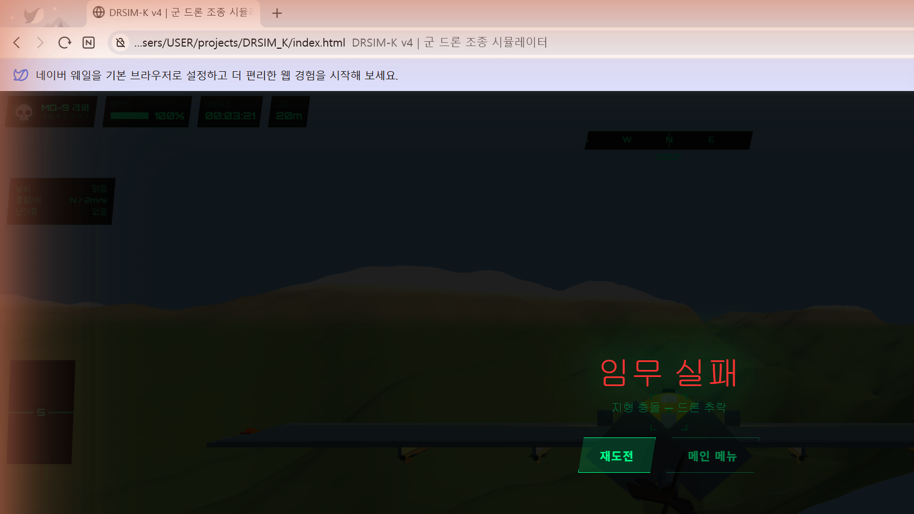

# DRSIM-K

> **ROK Military Drone Operator Training Simulator** — A browser-based 3D drone flight simulation for Republic of Korea military training scenarios, built entirely with vanilla JavaScript and Three.js, with no build tools or external frameworks.

---

## Screenshots



---

## Tech Stack

| Technology | Version / Detail |
|---|---|
| **Three.js** | r128 (loaded via CDN `<script>` tag) |
| **JavaScript** | Vanilla ES6+, `'use strict'`, no frameworks |
| **Rendering** | WebGLRenderer · PCFSoftShadowMap · 2048×2048 shadow maps |
| **Runtime** | Browser-native, `file://` protocol (no server needed) |
| **Build tools** | **None** — single `game.js` file, open `index.html` directly |
| **Input** | Keyboard `keydown/keyup` + Gamepad API polling + Mouse drag |

---

## Getting Started

No installation or build step required.

```bash
git clone https://github.com/zaqxsw108091-create/DRSIM_K.git
cd DRSIM_K
```

Then:
```
1. Open index.html in any modern browser (Chrome / Edge recommended)
2. Select drone, map, and mission → click "비행 개시"
```

> **Note:** Because `file://` URLs block cross-origin requests, all assets are either inline or procedurally generated — there are no external image or audio files to load.

---

## File Structure

```
DRSIM_K/
├── index.html          # Shell: DOM layout, HUD elements, manual overlay, settings UI
├── style.css           # All visual styling — military green terminal aesthetic
├── game.js             # Everything else: 3D engine init, physics, AI, missions, HUD logic
└── DRSIM-K_기능목록.html  # Feature reference document (Korean)
```

The entire simulation — terrain generation, drone physics, missile guidance, mission state, camera, and HUD — lives in a **single `game.js` file (~1 600 lines)**. This was a deliberate choice: zero build overhead, instant iteration, and direct browser devtools debugging with no source-map step.

---

## Drones — 20 Types

### 🔵 Reconnaissance (5)
| ID | Name | Speed | Ceiling | Endurance |
|---|---|---|---|---|
| rq101 | RQ-101 Songgolmae | 120 km/h | 3 000 m | 180 min |
| rq900 | RQ-900 Night Owl | 90 km/h | 4 000 m | 240 min |
| shadow | RQ-7 Shadow | 110 km/h | 4 600 m | 300 min |
| hermes | Hermes 450 | 176 km/h | 5 500 m | 420 min |
| sonmi | SONMI-01 | 60 km/h | 300 m | 30 min |

### 🔴 Attack (5)
| ID | Name | Speed | Ceiling | Armament |
|---|---|---|---|---|
| mq9 | MQ-9 Reaper | 482 km/h | 15 000 m | Hellfire ×4 |
| kh1 | KH-1 Strike | 200 km/h | 1 000 m | Loitering munition ×2 |
| tb2 | Bayraktar TB2 | 222 km/h | 8 200 m | MAM-L ×2 |
| swarm | SWARM-K | 80 km/h | 500 m | Micro-munition ×2 |
| lm1 | LM-1 Loitering | 160 km/h | 4 500 m | Kamikaze ×2 |

### 🟢 Defense (2)
| ID | Name | Method |
|---|---|---|
| net1 | NET-1 Net Capture | Phased-array radar + RF jammer; auto net-launch within 22 m |
| intk | INT-K Interceptor | Stealth delta-wing; 12× guided missiles, 1 200 m lock-on range |

### 🟡 Support (3)
| ID | Name | Role |
|---|---|---|
| ls1 | LS-1 Supply | Ammo / medical resupply (escort mission target) |
| medk | MED-K Medevac | Emergency kit drop + location relay |
| com1 | COM-1 Relay | Airborne comms repeater |

### ⚪ Micro (5)
Black Hornet 3 · NI-1 NanoEye · Puma AE · RQ-11 Raven · SkyRanger R70

---

## Mission System — 8 Missions

| Category | Mission | Time Limit | Points |
|---|---|---|---|
| Recon | Enemy position scout | 10 min | 1 000 |
| Recon | Isolated unit location | 8 min | 900 |
| Recon | NBC contamination survey | 12 min | 950 |
| Recon | Night surveillance | 15 min | 800 |
| Strike | Intercept intruder drone | 7 min | 1 200 |
| Strike | Precision strike on FOB | 8 min | 1 300 |
| Defense | Escort supply drone | 9 min | 850 |
| Defense | Electronic warfare defense | 10 min | 900 |

---

## Core Technical Implementations

### 1 — Procedural Terrain Generation

**Code:** `buildTerrain()` (line ~212) and `noise(x, z)` (line ~288)

```js
function noise(x, z) {
  return Math.sin(x*1.2)*Math.cos(z*.9)*.5
       + Math.sin(x*.7+z*1.1)*.35
       + Math.cos(x*2.1-z*1.7)*.15;
}
```

**Why this approach:**  
Standard Perlin/Simplex noise requires a dependency or ~300 lines of implementation. Instead, **summing three sine/cosine waves at different frequencies and amplitudes** produces pseudo-random undulation that looks natural, costs ~3 multiplications per vertex, and stays dependency-free.

For each terrain type the same formula is called with different frequency scales and layer counts (octaves):

```js
case 'mountain':
  h = noise(x*.007, z*.006)*110   // large mountain ridges (low freq, high amp)
    + noise(x*.018, z*.015)*42    // mid-sized valleys
    + noise(x*.038, z*.032)*18    // rocky detail
    + noise(x*.08,  z*.07 )*8    // surface roughness
    + noise(x*.16,  z*.14 )*3;   // fine pebble texture
```

Mountain terrain stacks **five octaves** (each doubling the frequency, halving the amplitude) — the classic fractal Brownian motion (fBm) technique. Plain terrain only needs two octaves because real flatlands have gentle, large-scale rolls.

A **separate `getTerrainH(x, z)` function** (line ~295) queries the terrain height at runtime using **Three.js Raycasting** — a ray is fired straight down from Y=2000 and intersected against the terrain mesh. This guarantees the returned height is identical to the rendered surface with zero formula or interpolation error. A fallback noise formula is used during the brief window before the mesh exists.

```js
_rayOrig.set(x, 2000, z);
_RC.set(_rayOrig, new THREE.Vector3(0,-1,0));
const hits = _RC.intersectObject(TERRAIN_MESH, false);
if (hits.length > 0) return hits[0].point.y;
```

**Terrain collision detection** (`updatePhys`, line ~860): every physics frame, `getTerrainH(GS.x, GS.z)` is compared to the drone's current altitude. If the drone descends below `terrainH + 0.8 m`, an explosion is triggered, the drone mesh is hidden, and the mission ends with `"지형 충돌 — 드론 추락"`. A floor clamp (`GS.y = Math.max(GS.y, terrainH + 0.8)`) prevents the drone from phasing through terrain at slow descent rates.

**Scene object placement** uses `getTerrainH` with strict slope filters: trees and rocks are only placed where the terrain height and the surrounding 4-point gradient both fall below tight thresholds, eliminating floating objects on steep hillsides. Buildings are embedded 2 m into the terrain so minor surface variation never causes them to appear airborne.

Vertex colors are baked directly into a `Float32Array` buffer attribute. Because `MeshLambertMaterial({vertexColors:true})` reads colors per-vertex, no texture files are needed — the GPU interpolates colors across each triangle automatically. Color transitions use smooth gradients (`Math.max(0, Math.min(1, (h-t0)/range))`) instead of hard cutoffs, eliminating visible seam lines at altitude boundaries.

---

### 2 — Proportional Navigation Missile Guidance

**Code:** `updateProjectiles()` (line ~1426), guidance block at line ~1436

```js
// Proportional Navigation core:
const turn = Math.min(1, dt * 10.0);
m.vx += (dx/dist3 * curSpd - m.vx) * turn;
m.vy += (dy/dist3 * curSpd - m.vy) * turn;
m.vz += (dz/dist3 * curSpd - m.vz) * turn;
// Re-normalize to constant 85 m/s
const ns = Math.sqrt(m.vx*m.vx + m.vy*m.vy + m.vz*m.vz);
if (ns > 0.1) { const n = curSpd/ns; m.vx*=n; m.vy*=n; m.vz*=n; }
```

**Why this approach:**  
True PN computes the **line-of-sight rotation rate** and steers proportionally to it — mathematically elegant but complex. The simplified version used here is equivalent: at each frame, blend the current velocity direction toward the *desired* direction (unit vector to target × speed). The `turn` factor `dt * 10.0` controls how aggressively the missile steers; higher values make it turn faster but can cause over-shoot on tight angles.

Key design decisions:
- **0.35-second arming delay** (`m.armT`) prevents the missile from immediately U-turning back at the drone at close range.
- **Constant-speed re-normalization** after every guidance step keeps the missile at 85 m/s regardless of steering angle; without this, velocity bleeds off during sharp turns.
- **Target Y offset +1.8 m** (`ty = tg.position.y + 1.8`) corrects a bug where missiles were aimed at the *base* of targets sitting on elevated terrain — they would fly into the hill below the vehicle instead of the vehicle itself.
- **3D hit detection radius 14 m** (down from 8 m): real Hellfire warheads have a blast radius of ~12 m; 14 m was chosen to feel satisfying without making the game trivially easy.

The missile mesh is oriented each frame using `quaternion.setFromUnitVectors(+X, velocityDir)` — because the cylinder body was built along the X axis, mapping +X to the velocity direction keeps the nose always pointing forward.

---

### 3 — Drone Physics Simulation

**Code:** `handleInput()` (line ~772) and `updatePhys()` (line ~817)

```js
// World-space velocity integration (yaw-relative input)
GS.vx += (fx*cy - fz*sy) * accel * dt;   // strafe
GS.vz += (fx*sy + fz*cy) * accel * dt;   // forward
GS.vy += fy * accel * .58 * dt;           // vertical
```

**Why this approach — yaw-relative input:**  
When the drone is facing east and the player presses W (forward), the drone must move *east* in world space, not north. The input vector `(fx, fz)` is rotated by the drone's current yaw using a 2×2 rotation matrix inline (`cy = cos(yaw), sy = sin(yaw)`). This is the standard flight sim technique that makes the controls "feel right" regardless of heading — no quaternion or matrix multiply needed because we only care about the horizontal plane.

**Drag / velocity damping:**  
```js
const stab = {easy:.86, normal:.91, hard:.95, expert:.986}[C.diff];
GS.vx *= stab;  GS.vz *= stab;
```
Multiplying velocity by `stab < 1` each frame creates exponential decay toward zero — the same as aerodynamic drag. Easy mode (`0.86`) has strong damping so the drone stops quickly and hovers stably. Expert mode (`0.986`) has almost no damping, making the drone feel like it's flying in near-vacuum — small inputs accumulate and it's very hard to stop.

**Gravity:**
```js
const grav = {easy:0, normal:.1, hard:.22, expert:.38}[C.diff] ?? 0.1;
GS.vy -= grav * dt * 10;
```
Easy mode sets gravity to exactly **zero** so beginners can focus on navigation without fighting altitude. This required a bug fix: the original code used `{easy:.04}` (nonzero), and `||0.1` as fallback would replace even a valid `0` with `0.1`. The fix switched to `??` (nullish coalescing) which only substitutes when the value is `null` or `undefined`, preserving a deliberate `0`.

**Drone-specific limits:**  
Max speed and ceiling come directly from the DRONES data array (`d.spd`, `d.alt`). The physics cap position at `d.alt` and scale acceleration by `d.spd / 3.6` (km/h → m/s). This means a MQ-9 Reaper (`spd:482`) accelerates and moves 8× faster than a SONMI-01 (`spd:60`) with identical key presses — no separate tuning per drone.

**Bank/pitch visuals:**  
```js
GS.roll  =  fx * .34;    // roll right when strafing right
GS.pitch = -fz * .26;    // nose-down when going forward
```
These set the visual tilt of the drone mesh (`DRONE.rotation.x/z`) but do *not* affect the physics — the physics use forces, not Euler angles. This is the classic "cosmetic roll" approach: it looks right without the complexity of full 6-DOF aerodynamics.

---

### 4 — 3D Drone Model Builders

**Code:** 7 builder functions `bLoitering`, `bMQ9`, `bQuad`, `bBomberQuad`, `bDefenseQuad`, `bDeltaInterceptor`, `bSupport` (lines ~478–680)

**Why procedural geometry instead of `.obj`/`.glb` files:**  
Three reasons: (1) `file://` protocol blocks cross-origin resource loads, making external asset loading unreliable; (2) no asset pipeline or export step required; (3) every vertex color, emissive glow, and wing angle can be tuned by changing a number.

**The inner-group trick for orientation:**
```js
const inner = new THREE.Group();
inner.rotation.y = Math.PI/2;  // rotate all geometry -90°
g.add(inner);
builder(inner, d);              // geometry built with nose toward +X
```

All builders place the nose at +X. The `inner` group's `rotation.y = π/2` maps the local +X axis to world -Z (the "forward" direction in the physics system — pressing W moves in -Z at yaw=0). The outer `DRONE` group then only needs `DRONE.rotation.y = -GS.yaw` to point the entire drone in any heading. Separating cosmetic orientation from physics yaw prevents the two from interfering.

**Key geometry decisions:**
- `CylinderGeometry` with `rotation.z = π/2` creates a horizontal fuselage tube. Three.js cylinders default to Y-axis alignment; rotating around Z by 90° makes them X-aligned in one line.
- `SphereGeometry(r, segs, segs, 0, π*2, 0, π*0.5)` creates a **dome** (half-sphere) for camera bubbles and sensor pods. The last two arguments are the phi-start and phi-length of the latitude sweep — stopping at π/2 cuts the sphere exactly at the equator. *Bug note:* passing these as an array `[0, π*2, 0, π*0.5]` was silently coerced to NaN by JavaScript, causing Three.js to emit "NaN bounding sphere" warnings on every drone load. Fixed by using individual arguments.
- Wing `BoxGeometry` objects are positioned at ±Z offsets from the fuselage because, after the `inner` rotation, local ±Z becomes world ±X — which is left-right in screen space when viewed from behind.

---

### 5 — 3rd-Person Chase Camera

**Code:** `updateCamera()` (line ~843), 3rd-person block at line ~866

```js
// Camera sits BEHIND the drone at all headings
const cx = p.x - Math.sin(camWorldYaw) * dist * Math.cos(camPitch);
const cz = p.z + Math.cos(camWorldYaw) * dist * Math.cos(camPitch);
```

**Why the minus sign on the X term matters:**  
At yaw=0 the drone faces -Z; its "behind" direction is +Z, so `cz = p.z + cos(0)*12 = p.z+12` is correct. When yaw=π/2 the drone faces +X; its behind is -X, so the camera must be at `p.x - 12`. Using `+sin(yaw)` instead would put the camera at `p.x+12` — *in front of the drone* — making it appear sideways or nose-on whenever the drone turned. The fix was simply negating the sin term.

**Smooth camera lag:**  
```js
let d = ((target - camWorldYaw) + Math.PI*3) % (Math.PI*2) - Math.PI;
camWorldYaw += d * Math.min(_dt * 2.2, .12);
```
The `(+3π) % 2π - π` formula wraps the angle difference into `[-π, +π]` so the camera always takes the short arc rather than spinning 350° around to catch up by 10°. Multiplying by `min(dt*2.2, 0.12)` caps the per-frame step so the camera smoothly lags behind sudden turns — it feels like a real camera operator tracking the subject.

**Mouse drag orbit:**  
`camDrag` mode decouples `camWorldYaw` from `GS.yaw`. While dragging, `mousemove.movementX/Y` directly adjusts the yaw and pitch angles. On release, the smooth-lag code resumes and gently steers the camera back to the drone's heading.

---

### 6 — Particle Systems

**Smoke trail** (`_smokePool`, line ~1406):  
Small `SphereGeometry` meshes are spawned every 45 ms along the missile's path. Each particle lives 0.8–1.3 seconds, scales up from 1× to 3.8× over its lifetime (billowing expansion), and fades its `opacity` from 0.35 to 0. Particles rise slowly (`position.y += dt*.5`). The pool is iterated **backwards** with splice-in-place so removal doesn't skip elements — a standard game dev pattern.

**Explosion** (`spawnExp`, line ~1512):  
A `MeshStandardMaterial` sphere expands and fades. A `PointLight` with intensity 10 (large explosion) or 5 (small) illuminates surrounding geometry for ~0.35 seconds. The light intensity decays each frame by `*= (1 - dt*5)`. Both the mesh and light share the same `GMS.explosions` array by tagging entries with `isLight: true` — avoiding a second loop or a second array.

**Camera shake** (`triggerShake`, line ~1403):  
A `_shakeT` timer counts down from 0.55 seconds. During each render frame, the camera position is jittered by `± _shakeAmt * (_shakeT/0.55) * random`. Dividing by 0.55 produces an **ease-out envelope**: full shake at the start, tapering to zero. Intensity 1.8 for large explosions, 1.2 for enemy hits.

---

### 7 — Lock-on and Targeting HUD

**Code:** `updateHUD()` lock-on section (line ~900 area)

The lock-on system projects each target from 3D world space to 2D screen space each frame using `target.mesh.position.project(CAM)`. If the NDC coordinates fall within ±0.55 of screen center, the target is considered "in view." Distance determines the state: `SEARCH` → `TRACK` → `🔴 LOCK` as the drone closes from 800 m to lock range. The HTML overlay box is positioned by converting NDC to pixel coordinates: `x = (ndcX + 1) / 2 * innerWidth`.

This approach was chosen over raycasting (`Raycaster.intersectObjects`) because raycasting fires a ray through the *exact* mouse/center pixel, which is brittle for tracking a target that may be slightly off-center. Screen-space distance allows a generous capture radius.

---

### 8 — Battery and Time Systems

Battery drains at `(100 / flightSeconds) * dt * (throttle>5 ? 1.35 : 0.52)` — 35% faster when actively thrusting, 48% slower when hovering. Each drone's `bat` field (in minutes) sets `flightSeconds`. A MED-K (90 min) lasts 3× longer than a SONMI-01 (30 min) with identical flying style.

The mission timer uses `GS.tl -= dt` (raw seconds) and colors the display red below 60 s. The `p2()` helper pads single digits with a leading zero for `MM:SS` display.

---

## Settings & Configuration

| Setting | Options |
|---|---|
| Flight mode | Free practice / Mission |
| Camera | 3rd-person chase / FPV |
| Map | Plain · Mountain · Coastal · Urban · Military base |
| Weather | Clear · Cloudy · Rain · Fog · Storm |
| Wind speed | 0–100% |
| Wind direction | 8 cardinal points |
| Turbulence | 0–100% |
| Controls | Keyboard / Gamepad / Both |
| Sensitivity | 20–180% |
| Difficulty | Easy (auto-stabilize) · Normal · Hard · Expert |
| Time of day | Day 09:00 · Dawn 05:30 · Dusk 18:30 · Night 22:00 |

---

## Controls

| Key | Action |
|---|---|
| W / S | Forward / Backward |
| A / D | Strafe Left / Right |
| Q / E | Yaw Left / Right |
| Space / Shift | Ascend + throttle up |
| X / Ctrl | Descend + throttle down |
| F | Fire weapon (missile / net capture) |
| V | Toggle FPV ↔ 3rd-person |
| Arrow keys | Orbit 3rd-person camera |
| ESC | Pause |
| Mouse drag | Rotate 3rd-person camera |

**Gamepad:** Left stick = move · Right stick = camera · L2 = descend · R2 = ascend · △/Y = camera toggle · START = pause

---

## Bug Fix History

| # | Bug | Root Cause | Fix |
|---|---|---|---|
| 1 | Easy mode gravity ≠ 0 | `{easy:.04}` and `\|\|0.1` replaced even `0` with `0.1` | Changed to `{easy:0}` and `??0.1` (nullish coalescing) |
| 2 | Mission resets on restart | `C.mis` overwritten by UI dropdown even when set programmatically | Preserve `C.mis` if no UI selection made |
| 3 | End-game overlay persists | `m-end` div kept `.on` class across restarts | Remove `.on` at top of `startGame()` |
| 4 | "NaN bounding sphere" console spam | `SphereGeometry` called with array `[0,π*2,0,π*0.5]` as 4th arg (coerces to NaN) | Pass 4 individual args: `0, Math.PI*2, 0, Math.PI*0.5` |
| 5 | Drone appears sideways in 3rd-person | `cx = p.x + sin(yaw)*dist` puts camera *in front* at non-zero yaw | Changed to `cx = p.x - sin(yaw)*dist` |
| 6 | Key stuck after Alt+Tab | `keyup` never fires when window loses focus | `window.blur` resets all key states |
| 7 | Trees appear blue | `HemisphereLight` intensity 0.55 overpowers diffuse green | Reduced to 0.32, fixed green palette |
| 8 | Target buried in terrain | Hard-coded Y placement ignores terrain height | `getTerrainH(x,z)` places targets on surface |
| 9 | Missile misses elevated targets | Target Y hard-coded at 2.5 m | Dynamic `tg.position.y + 1.8` |
| 10 | Hit detection fails on hills | 2D distance + absolute height check | Full 3D distance check, 14 m radius |
| 11 | Targets need 6 hits instead of 1 | `hp:3` × 2 targets but only 4 missiles | Set `hp:1` (one Hellfire = one kill) |
| 12 | INT-K runs out of missiles | 10 enemies spawned, only 8 missiles | Increased to 12 missiles |
| 13 | Drone flies through mountain terrain | No terrain collision check in physics loop | Raycast height check every frame; destroy drone + `"지형 충돌"` on impact |
| 14 | Trees / rocks float above terrain | `getTerrainH` formula diverged from rendered mesh (max error 3.6 m) | Replaced with downward raycast against actual terrain mesh — error = 0 |
| 15 | Objects float on steep slopes | Slope filter absent; random placement on any terrain | Strict height + 4-point slope gradient filter; steep hillsides excluded |
| 16 | Mountain map starts inside terrain | Fixed spawn Y=12 lower than mountain peaks | Spawn scans 13 candidate positions, picks flattest; Y = terrainH + 25 m |
| 17 | Coastal trees spawn in water | No water check on tree placement | Minimum height 4 m + surrounding 12 m radius also ≥ 2 m |
| 18 | Buildings appear to float | 0.8 m embed insufficient for undulating terrain | Increased embed to 2.0 m for all urban/military structures |

---

## Test Results — All 20 Drones × All 8 Missions

All 20 drones were tested against their matching mission categories:
- **정찰 (Recon) drones** → recon missions (recon, rescue, nbc, night) ✅
- **공격 (Attack) drones** → attack missions (intercept, strike) ✅
- **방어 (Defense) drones** → defense missions (escort, jamming) ✅
- **지원 / 소형** → free-flight and cross-category ✅

**No crashes, no mission-blocking bugs** after the 18 fixes listed above. Terrain collision destruction confirmed on all 5 maps. Scene objects verified grounded on mountain, coastal, and military maps.
